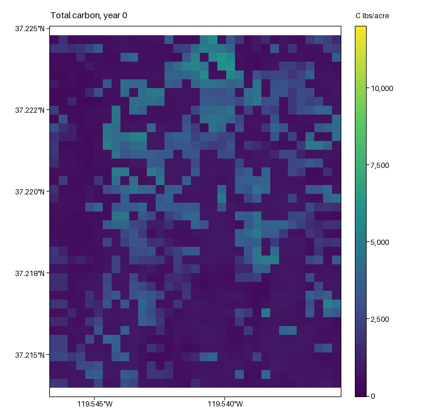
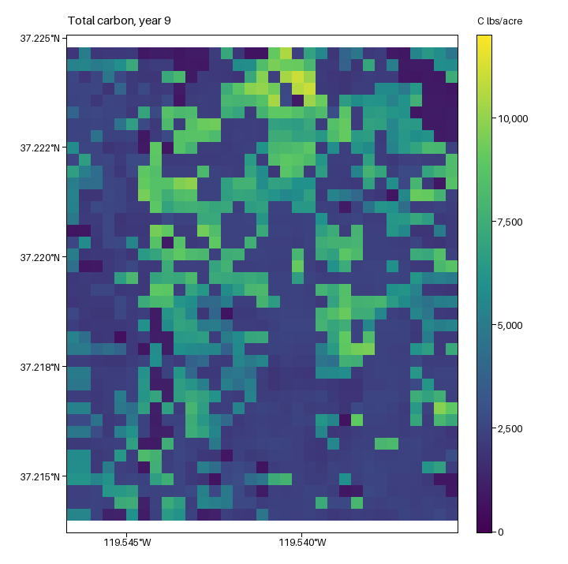
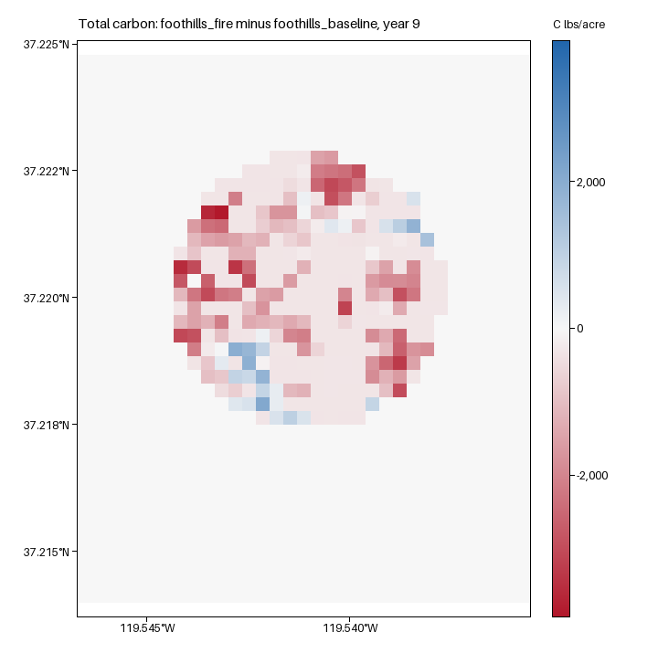

# Running RVS: a hands-on tutorial

The **Rangeland Vegetation Simulator (RVS)** projects shrub and herb growth, biomass, and carbon on rangeland plots, year by year.

**Input**: SQLite db with plot herb height and % cover and each shrub species' height and % cover.

**Output**: SQLite DB

This tutorial walks through the full workflow in four parts:

1. [Run the test database](#part-1-run-the-test-database)
2. [Add your own data](#part-2-add-your-own-data)
3. [Map the results](#part-3-map-the-results)
4. [Add disturbances](#part-4-add-disturbances)


> The example data are for learning the workflow. The inputs may not be up to date.

---

## Before you start

### What you need

- **Docker Desktop:** Must be open and running to run RVS. Download: <https://www.docker.com/products/docker-desktop/>
- **DB Browser for SQLite**, for looking at and editing RVS databases. Download: <https://sqlitebrowser.org/dl/>
- A terminal: **PowerShell** on Windows, or **Terminal** on a Mac. (VSCode's built-in terminal works too.)

### Set up a tutorial folder

1. Download **[RVS_tutorial.zip](RVS_tutorial.zip)** (3 MB).
2. Unzip it somewhere easy to find, such as `C:\RVS_tutorial`. Avoid OneDrive or network folders as Docker works best with local folders.
   - **Windows:** right-click the zip, choose **Extract All…**, and pick `C:\`.
   - **Mac:** double-click the zip, then move the `RVS_tutorial` folder where you want it.

The folder is ready to use:

```
RVS_tutorial/
├────── inputs/    (.db and .csv files)
├────── out/       (empty; results go here)
└────── tools/     (make_raster.py)
```

What's in `inputs`:

- `2026_template.db` — a small test database (11 plots)
- `foothills_plots.csv` and `foothills_shrubs.csv` — plot and shrub data for a small landscape, used in Part 2
- `disturb_fire.csv` — a fire example for Part 4
- `foothills_demo.db` — the finished Part 2 database, in case you want to skip ahead

### Open a terminal

- **Windows:** open the `RVS_tutorial` folder in File Explorer, click in the address bar, type `powershell`, and press enter.
- **Mac:** open Terminal, type `cd ` (with a space), drag the `RVS_tutorial` folder into the window, and press enter.

- (Or open a terminal and navigate to the folder any way you know how).

Every command in this tutorial is run from this folder.

### Download the software images

Make sure Docker Desktop is running, then paste these two commands (one at a time):

```
docker pull inglisn/rvs-2026-dev
```

```
docker pull ghcr.io/osgeo/gdal:ubuntu-small-3.9.3
```

The first is RVS. The second is a mapping toolkit used in Part 3. This takes about a minute or two, and you only need to do this once.

### How an RVS command works

Every RVS run uses the same pattern:

```
docker run --rm -v "${PWD}:/data" -w /data inglisn/rvs-2026-dev rvs INPUT OUTPUT YEARS CLIMATE
```

| Paramter | Meaning |
|---|---|
| `docker run --rm` | Start the Docker container and clean it up when it's done |
| `-v "${PWD}:/data" -w /data` | Shares the path to the folder you're in to the data folder within the container |
| `inglisn/rvs-2026-dev rvs` | Run 'rvs' (command to run the model) in this Docker container |
| `INPUT` | The database RVS reads, such as `inputs/2026_template.db` |
| `OUTPUT` | Where RVS writes results, such as `out/test_1yr.db`. Overwrites if the output already exists. |
| `YEARS` | How many years to simulate (1 or more) |
| `CLIMATE` | Random climate. `false` uses a normal-precipitation year every year. `true` picks a dry, normal, or wet year at random each year. |

---

## Part 1: Run the test database

### Step 1.1 Run one year

```
docker run --rm -v "${PWD}:/data" -w /data inglisn/rvs-2026-dev rvs inputs/2026_template.db out/test_1yr.db 1 false
```

RVS prints some setup messages, followed by banners for each year of simulation. The last line should (satisfyingly) be:

```
Ran to completion.
```

You now have a results file in your local folder: `out/test_1yr.db`, and a log file, `RVS_Debug.txt`. The log is useful if something goes wrong.

### Step 1.2: Check results

1. Open DB Browser for SQLite.
2. Click **Open Database** and choose `out/test_1yr.db`.
3. Click the **Browse Data** tab, then choose **Biomass_Output** from the **Table** list.

<!-- SCREENSHOT: DB Browser, Browse Data tab, Biomass_Output selected -->

Each row is one plot in one year. The columns you'll use most:

| Column | Meaning | Units |
|---|---|---|
| `PLOT_ID` | Plot number | |
| `year` | Simulation year. The first year is **0**. | |
| `shrub_biomass` | Shrub biomass | lbs/acre |
| `herb_biomass` | Herb (grass and forb) biomass | lbs/acre |
| `total_biomass` | Shrub + herb biomass | lbs/acre |
| `total_carbon` | Carbon in that biomass (half of `total_biomass`) | C lbs/acre |
| `tot_shrub_cov` | Total shrub cover | % |
| `avg_shrub_ht` | Average shrub height, weighted by cover | cm |
| `disturbance_amount` | Biomass removed by grazing that year (fire is not recorded here) | lbs/acre |

Your first rows should look like this:

```
PLOT_ID  year  shrub_biomass  herb_biomass  total_biomass  total_carbon  tot_shrub_cov
2026001  0     6056           1191.2        7247           3624          45
2026002  0     2741           804.7         3546           1773          52.2
2026003  0     10855          927.9         11783          5891          50
```

### Step 1.3:Run ten years
Try to adjust the command on your own for a 10-year run. 

<details>
<summary> <b>Code for  10-year run here</b> </summary>

<pre><code>docker run --rm -v "${PWD}:/data" -w /data inglisn/rvs-2026-dev rvs inputs/2026_template.db out/test_10yr.db 10 false</code></pre>

</details>
<br>

- Open `out/test_10yr.db` in DB Browser. There are now 10 rows per plot, for years 0 through 9.

### Step 1.4: Summarize and chart the results

DB Browser can summarize results with a short query.

1. Click the **Execute SQL** tab.
2. Paste this query:

   ```sql
   SELECT year, ROUND(AVG(total_carbon)) AS avg_carbon
   FROM Biomass_Output
   GROUP BY year;
   ```

3. Click the **Run** button (▶), or press **Ctrl+Enter**.

You'll see the average carbon across all plots for each year:

```
year  avg_carbon
0     8019
1     8698
2     9310
...
9     13711
```

To chart it: open the **View** menu and choose **Plot**. In the Plot panel, set the **X** axis to `year` and tick `avg_carbon` for the **Y** axis.

<!-- SCREENSHOT: DB Browser Plot panel showing avg_carbon by year -->

To look at a single plot instead, change the query to `SELECT year, total_carbon FROM Biomass_Output WHERE PLOT_ID = 2026003;`.

---

## Part 2: Add your own data

RVS reads plot information from two tables in its input database:

- **Plots_Active** — one row per plot: location, vegetation type, herb cover, and climate.
- **Shrubs_Active** — one row per shrub species on each plot: species, cover, and height. There may be multiple or zero rows for each `PLOT_ID`

`PLOT_ID` links the two. To bring in your own data, you copy the test database, clear out the example plots, and import your plots and shrubs from CSV files.

In this tutorial, "your own data" is a real landscape: 1,600 'plots', one per 30 m pixel, covering about 1 × 1.2 km of the Sierra Nevada foothills northeast of Fresno. Vegetation type and succession class come from LANDFIRE 2024. Most plots are blue oak savanna or chaparral, with a few riparian and sparsely vegetated pixels. The plots are in `foothills_plots.csv` and their shrubs (all  are in `foothills_shrubs.csv`.

### Step 2.1: Make a copy of the test database

In File Explorer (or Finder), copy `inputs/2026_template.db` and name the copy `inputs/foothills.db`. Always work on a copy and keep a clean original version.

### Step 2.2: Look at the data

Open `foothills_plots.csv` and `foothills_shrubs.csv` in a text editor or Excel to see how they're laid out. For your own project, your files need these same columns, in the same order.

**Plots_Active columns**

| Column | Description |
|---|---|
| `PLOT_ID` | Unique plot identifier |
| `BPS_CODE` | LANDFIRE Biophysical Setting code, such as `11050` |
| `BPS_NAME` | LANDFIRE Biophysical Setting name (for your reference) |
| `BPS_MODEL` | LANDFIRE BPS model code: 7 digits (keep the leading zero), such as `0611050` where the first two digits are the BPS zone |
| `herb_cover` | Herb cover, % |
| `herb_height` | Herb height, cm |
| `latitude`, `longitude` | Decimal degrees (WGS84) |
| `PPT_1` … `PPT_5` | Annual precipitation (mm) for a dry, mid-dry, normal, mid-wet, and wet year |
| `NDVI_1` … `NDVI_5` | NDVI × 10,000 for the same five years |
| `NPP_1` … `NPP_5` | *Optional, in place of PPT and NDVI.* Net primary production for the same five years. If these columns exist, RVS uses them and ignores PPT and NDVI.  |
| `sclass` | LANDFIRE succession class: `1`–`5` for classes A–E, `6` or `7` for uncharacteristic, `0` if unknown (RVS will estimate it from cover) |

**Shrubs_Active columns**

| Column | Description |
|---|---|
| `PLOT_ID` | Must match a plot in Plots_Active |
| `PLOT_NAME` | Any label |
| `dom_spp` | Common or scientific name (for your reference) |
| `spp_code` | USDA PLANTS code, such as `ADFA` or `ARTRW8` |
| `cover` | Shrub cover |
| `height` | Shrub height, cm |
| `BPS_CODE`, `BPS_NAME` | Same as the plot |
| `height_ft` | Height in feet (`height` ÷ 30.48) |
| `o_code` | Same as `spp_code` |

> **Excel tip:** Excel drops leading zeros, so `0611050` becomes `611050`. If you open the tutorial CSVs in Excel, close them without saving. When you make your own files in Excel, select the `BPS_MODEL` column, choose **Format Cells → Text** before typing the codes, and save as **CSV (Comma delimited)**.

### Step 2.3: Clear out the example plots

1. In DB Browser, open `inputs/foothills.db`.
2. In the **Execute SQL** tab, run:

   ```sql
   DELETE FROM Plots_Active;
   DELETE FROM Shrubs_Active;
   DELETE FROM Disturbance_Plots;
   ```

3. Click **Write Changes** (or press **Ctrl+S**).

### Step 2.4: Import the CSV files

1. Choose **File -> Import -> Table from CSV file…** and pick `foothills_plots.csv`.
2. In the import window:
   - Change **Table name** to `Plots_Active`.
   - Make sure **Column names in first line** is ticked.
   - Leave the separator as a comma.
3. Click **OK**. When DB Browser says the table already exists and asks whether to import into it, click **Yes**.
4. Repeat for `foothills_shrubs.csv`, with **Table name** set to `Shrubs_Active`.


On the **Browse Data** tab, Plots_Active should now have 1,600 rows and Shrubs_Active 618.

### Step 2.5: Convert shrub numbers

DB Browser imports the shrub cover and height as text. Run this in **Execute SQL** to turn them back into numbers:

```sql
UPDATE Shrubs_Active
SET cover = CAST(cover AS REAL), cover_o = CAST(cover_o AS REAL),
    height = CAST(height AS REAL), height_ft = CAST(height_ft AS REAL);
```

### Step 2.6: Check your data

Run each query below in **Execute SQL**. Each should return **no rows**. 

Shrub species RVS doesn't recognize:

```sql
SELECT DISTINCT spp_code FROM Shrubs_Active
WHERE spp_code NOT IN (SELECT spp_code FROM Bio_Crosswalk);
```

BpS model codes that lost their leading zero:

```sql
SELECT PLOT_ID, BPS_MODEL FROM Plots_Active WHERE length(BPS_MODEL) <> 7;
```

Shrub rows whose plot is missing:

```sql
SELECT DISTINCT PLOT_ID FROM Shrubs_Active
WHERE PLOT_ID NOT IN (SELECT PLOT_ID FROM Plots_Active);
```

Then click **Write Changes**.

### Step 2.7: Run ten years

```
docker run --rm -v "${PWD}:/data" -w /data inglisn/rvs-2026-dev rvs inputs/foothills.db out/foothills_baseline.db 10 false
```

With 1,600 plots, this takes about five minutes. Wait for `Ran to completion.`

Open `out/foothills_baseline.db` in DB Browser and run the average-carbon query from Step 1.4. You should see:

```
year  avg_carbon
0     1580
1     1878
2     2076
3     2296
...
9     3941
```

This run is the **baseline**: the landscape with no disturbance. Part 3 maps it, and Part 4 compares fire and grazing against it.

> **Stuck?** `foothills_demo.db` is a finished copy of `foothills.db`. Put it in `inputs`, and use it in place of `inputs/foothills.db` in the command above.

---

## Part 3: Map the results

RVS results are tables, but each plot has a location, so results can be turned into maps. The tool `make_raster.py` places each plot's value on a 30 m grid and saves a **GeoTIFF** (for QGIS or ArcGIS) and a **PNG** map with a legend.

This part maps the baseline run from Step 2.7.

### Step 3.1: See what you can map

```
docker run --rm -v "${PWD}:/data" -w /data ghcr.io/osgeo/gdal:ubuntu-small-3.9.3 python3 tools/make_raster.py out/foothills_baseline.db --list
```

This lists the years and variables in the results, such as `total_biomass`, `total_carbon`, `shrub_biomass`, and `tot_shrub_cov`.

### Step 3.2: Make carbon maps of first and last year outputs

```
docker run --rm -v "${PWD}:/data" -w /data ghcr.io/osgeo/gdal:ubuntu-small-3.9.3 python3 tools/make_raster.py out/foothills_baseline.db --variable total_carbon --year 0,9 --png --min 0 --max 12000
```

You should see:

```
Year 0: 1600 plots -> rasters/foothills_baseline_total_carbon_year0.tif  (33 x 42 cells, min 337.0, mean 1580.2, max 6304.7)
         map -> rasters/foothills_baseline_total_carbon_year0.png
Year 9: 1600 plots -> rasters/foothills_baseline_total_carbon_year9.tif  (33 x 42 cells, min 573.8, mean 3940.9, max 11319.2)
         map -> rasters/foothills_baseline_total_carbon_year9.png
```

The files are in a new `rasters` folder. Open the PNGs to see the maps:

| Year 0 | Year 9 |
|---|---|
|  |  |

### make_raster.py options

| Option | What it does | Default |
|---|---|---|
| `--variable` | Column to map | `total_biomass` |
| `--year` | A year (`9`), a list (`0,5,9`), `last`, or `all` | `last` |
| `--png` | Also save a PNG map with a legend and latitude/longitude | off |
| `--min`, `--max` | Fix the PNG color scale (use the same values to compare maps) | data range |
| `--compare BASE.db` | Map the difference from another run (see Part 4) | |
| `--cell-size` | Cell size in meters | `30` |
| `--epsg` | Map projection | `3310` (California Albers) |
| `--out-dir` | Output folder | `rasters` |
| `--list` | List variables and years, then stop | |

---

## Part 4: Add disturbances

RVS can apply **grazing** or **fire** to any plot in any year. Disturbances are listed in the **Disturbance_Plots** table of the input database, one row per plot and disturbance.

| Column | Example | Meaning |
|---|---|---|
| `PLOT_ID` | `42707` | Plot to disturb |
| `PLOT_NAME` | `FH_42707` | Any label |
| `DIST_TYPE` | `GRAZE` | `GRAZE` or `FIRE` |
| `DIST_SUBTYPE` | `SHEEP` | Grazing: `COW`, `SHEEP`, or `GOAT`. Fire: `WILDFIRE` or `CONTROLLED`. |
| `START_YEAR` | `3` | First year of disturbance (simulation starts at year 0) |
| `STOP_YEAR` | `5` | Last year of disturbance|
| `FREQ` | `1` | Repeat every year. `2` is every other year; `0` means once, in `START_YEAR` only. |
| `P1_VAL` | `100` | Grazing: number of animals. Fire: intensity. |
| `P2_VAL` | `20` | Grazing: pasture area, acres |
| `P3_VAL` | `30` | Grazing: days grazed |

**Grazing** removes biomass each year it happens. 

- Sheep and goats remove 5.2 × animals × days ÷ acres, in lbs/acre.
- Cattle remove 26 × animals × days ÷ acres, in lbs/acre.

The example above removes 5.2 × 100 × 30 ÷ 20 = 780 lbs/acre.

**Fire** resets shrub and herb cover on the plot to near zero in the year it happens. The plot then regrows from early successional stage defined in BPS.

We'll burn a part of the landscape, then graze one plot with sheep and compare each to the baseline from Step 2.7.

### Step 4.1: Fire scenario

`disturb_fire.csv` describes a wildfire burning about 400 plots (a patch roughly 600 m across) in year 3.

1. Copy `inputs/foothills.db` and name the copy `inputs/foothills_fire.db`.
2. Open `foothills_fire.db` in DB Browser.
3. Choose **File → Import → Table from CSV file…**, pick `disturb_fire.csv`, set **Table name** to `Disturbance_Plots`, and click **OK**, then **Yes**.
4. Click **Write Changes**.

### Step 4.2: Run the fire scenario

```
docker run --rm -v "${PWD}:/data" -w /data inglisn/rvs-2026-dev rvs inputs/foothills_fire.db out/foothills_fire.db 10 false
```


### Step 4.3: Results comaprison

Run the average-carbon query from Step 1.4 on `out/foothills_fire.db`. Next to the baseline:

| Year | Baseline | Fire |
|---|---|---|
| 0 | 1,580 | 1,580 |
| 2 | 2,076 | 2,076 |
| 3 | 2,296 | **1,603** |
| 6 | 3,149 | 2,704 |
| 9 | 3,941 | 3,773 |

Average total carbon, C lbs/acre, across all 1,600 plots.


### Step 4.4: Map the difference

`--compare` maps one run minus another, plot by plot:

```
docker run --rm -v "${PWD}:/data" -w /data ghcr.io/osgeo/gdal:ubuntu-small-3.9.3 python3 tools/make_raster.py out/foothills_fire.db --compare out/foothills_baseline.db --variable total_carbon --year 9 --png
```



Red is less carbon than the baseline, white is no change, and blue is more. 

### Step 4.5: Graze one plot with sheep

This adds the example row from the table above: 100 sheep on plot 42707, an oak savanna plot, in years 3 to 5.

1. Copy `inputs/foothills.db` and name the copy `inputs/foothills_sheep.db`.
2. Open `foothills_sheep.db` in DB Browser. On the **Browse Data** tab, choose **Disturbance_Plots** and click **New Record**.
3. Type in the example values from the table at the top of Part 4.
4. Click **Write Changes**, then run:

```
docker run --rm -v "${PWD}:/data" -w /data inglisn/rvs-2026-dev rvs inputs/foothills_sheep.db out/foothills_sheep.db 10 false
```

Grazing shows up in the fuels results. In DB Browser, open `out/foothills_sheep.db` and run this in **Execute SQL**, then run it on `out/foothills_baseline.db` to compare:

```sql
SELECT year, ROUND(herb_fuel) AS herb_fuel, ROUND(shrub_1hr_foliage) AS shrub_foliage, FBFM
FROM Fuels_Output
WHERE PLOT_ID = 42707;
```

| Year | Herb fuel, baseline | Herb fuel, sheep | Shrub foliage, baseline | Shrub foliage, sheep | Fuel model, baseline | Fuel model, sheep |
|---|---|---|---|---|---|---|
| 2 | 1,973 | 1,973 | 14 | 14 | GR2 | GR2 |
| 3 | 2,004 | **1,381** | 43 | **0** | GR2 | GR2 |
| 4 | 1,961 | **1,301** | 162 | **0** | GS2 | **GR2** |
| 5 | 1,918 | **1,335** | 194 | **0** | GS2 | **GR2** |
| 6 | 1,875 | 1,966 | 230 | 133 | GS2 | GS2 |


### Making your own disturbances

Add rows to **Disturbance_Plots** in your own database, either by importing a CSV laid out like `disturb_fire.csv` or by typing rows in DB Browser (**Browse Data** tab, choose the table, click **New Record**). Then click **Write Changes** and run RVS. `PLOT_ID`s in **Disturbance_Plots** *must* correspond to a `PLOT_ID` in **Plots_Active**. 

---

## Troubleshooting

| Problem | What to do |
|---|---|
| `error during connect` or `Cannot connect to the Docker daemon` | Start Docker Desktop and wait until it says it's running. |
| `unable to open database file` | Check you're in the `RVS_tutorial` folder and the file name and folder are spelled exactly. |
| `Ran to completion.` but no rows in the results | The number of years must be 1 or more. |
| Shrubs start at zero cover | Run the conversion query in Step 2.5, then Write Changes. |
| Your changes don't show up in the results | Click **Write Changes** in DB Browser before running RVS. |
| A plot is missing from the results | Look for its `PLOT_ID` in `RVS_Debug.txt`. |
| The terminal says `"${PWD}:/data"` is invalid | Use PowerShell, not Command Prompt. In Command Prompt, replace `"${PWD}:/data"` with `"%cd%:/data"`. |

---

## Sources and links

- **RVS source code:** [gearslaboratory/RVS](https://github.com/gearslaboratory/RVS), `dev` branch.
- **Docker image:** `inglisn/rvs-2026-dev` on Docker Hub, built from the `dev` branch.
- **Demo landscape:** LANDFIRE Biophysical Settings and Succession Class (S-Class v1.4.0) for a 40 × 40 pixel area in the Sierra Nevada foothills northeast of Fresno, California.
- **Map tool:** `make_raster.py` runs in the GDAL Docker image (`ghcr.io/osgeo/gdal`), so no Python install is needed.
